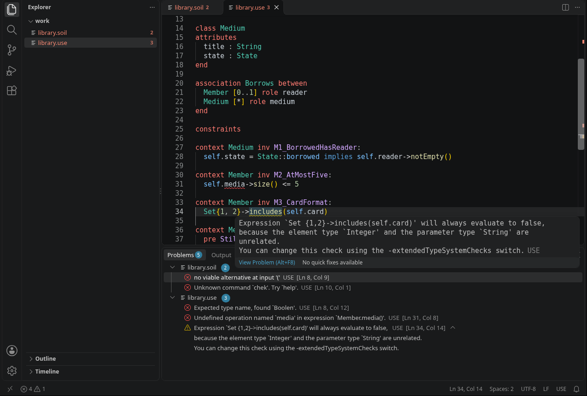

:toc:
:toclevels: 5
:toc-placement!:
:source-highlighter: highlight.js
ifdef::env-github[]
:tip-caption: :bulb:
:note-caption: :information_source:
:important-caption: :heavy_exclamation_mark:
:caution-caption: :fire:
:warning-caption: :warning:
:github-repository: https://github.com/WSE-research/USE-OCL-vscode
endif::[]

++++
<a href="https://wse-research.org/" title="go to the WSE research group">
<!-- relative path: the repo is private, so GitHub's camo proxy cannot load an absolute raw URL; a relative src is rewritten to an authenticated URL -->

</a>
++++

= USE OCL for Visual Studio Code

Syntax highlighting and live validation of USE models (`.use`) and Soil scripts (`.soil`) in Visual Studio Code, checked by the compiler of https://github.com/useocl/use[USE 7.5] itself. An extension of the https://wse-research.org/[Web & Software Engineering research group] at https://www.htwk-leipzig.de/[Leipzig University of Applied Sciences (HTWK Leipzig, Germany)], made for the UML/OCL exercises of the software engineering course.

USE reports the errors of a model only when the model is loaded, and the error of a Soil script only when the line runs. The extension runs the same compiler while you type: errors and warnings appear as squiggles in the editor and in the *Problems* view, with the messages and positions of `use -c`.

* *Highlighting* — TextMate grammars for models and Soil scripts, with the keywords taken from the grammars of USE 7.5.
* *Validation while typing* — everything `use -c` checks: syntax, the names of classes, attributes, roles and operations, and the types in OCL expressions.
* *Warnings with a position* — type-system warnings such as `Set{0, 1, 2}->includes('2')` (always false) are marked where they occur; USE itself prints them without a line number.
* *Soil scripts line by line* — as the USE shell reads them: the syntax of statements after `!` and of queries after `?`, `??` and `:`, unknown commands (usually a forgotten `!`) and `=` where `:=` was meant.
* *No local USE needed* — the language server runs in the container image `use-ocl:7.5.0` with Docker or Podman, the image of https://github.com/WSE-research/USE-OCL-docker[USE-OCL-docker]; with Java 21 and a USE installation it runs without a container.
* *Builds its own image* — if the image is missing, the extension offers to build it.

.A model and a Soil script with mistakes: highlighting, squiggles, the hover with a warning that USE itself prints without a position, and the *Problems* view with USE's messages

---

toc::[]

---

== Feature overview

|===
|Area |Highlights

|Models
|Every check of `use -c`, with USE's own messages; a duplicate declaration also marks the first one as information. Type-system warnings, which USE prints without a position, are placed on the expression that causes them. An error at the end of the file is shown at the end of the last line rather than behind it.

|Soil scripts
|Each line is checked as the USE shell reads it: statements after `!` and `!!` with the shell's own parser (which also knows `openter`, `opexit` and `create x : C`), expressions after `?`, `??` and `:` for their syntax, and every other line against the commands of the shell, with a hint when it looks like a statement without `!`. A statement such as `!obj.attr = 3` is marked: Soil assigns with `:=`. Whether classes, attributes and objects exist is not checked, because the objects of a script are often created by another one; run the script in USE for that (for instance with `run-use.sh -nogui model.use script.soil`).

|Highlighting
|Keywords, class, association, enumeration and state machine names, invariant and condition names, attributes and roles, OCL types, collection operations after `->`, enumeration literals (`Status::open`), strings, numbers and comments (`--`, `//`, `/* */`). In Soil scripts also the command markers `!`, `?`, `??`, `:` and the commands of the USE shell. Comment toggling, bracket matching and folding of class and association blocks come with it.

|Language server
|Starts when the first `.use` or `.soil` file is opened (about a second in the container) and checks a file 250 ms after the last change. In the container it runs without network access and sees only its own code, mounted read-only; the files reach it as text through the connection to VS Code.

|Docker and Podman
|Picks the engine as `run-use.sh` does: the first one whose `info` works, Docker first. If Podman's default storage cannot be used, as on the Linux PCs of the university (home on NFS, no subuid ranges), it uses the same private store under `/var/tmp/use-ocl-<uid>` (`USE_PODMAN_STORE` changes it). On SELinux hosts the container runs with `label=disable`.

|Without a container
|With `useOcl.useHome` pointing to a USE 7.5 installation and Java 21 (`useOcl.javaHome`, `JAVA_HOME` or `java` on the `PATH`), the server runs as a local Java process.
|===

The user interface of the extension (commands, settings, notifications) is in German, like the course; the messages of USE itself are in English.

== Architecture

Two parts: the client `extension.js`, which starts the language server and connects it to VS Code through https://github.com/microsoft/vscode-languageserver-node[vscode-languageclient], and the language server in `java/`, written with https://github.com/eclipse-lsp4j/lsp4j[LSP4J] (package `de.htwk.uselsp`). The client finds a way to run the server — a local Java 21 when `useOcl.useHome` is set, the container otherwise — offers to build a missing image as a VS Code task from `container/Dockerfile`, and restarts the server when a setting changes. The server keeps the open documents, checks each one after a change and publishes the result as diagnostics; it checks on a single thread, because USE keeps global state.

Four decisions carry most of the design:

* *USE checks, the server translates.* Models go through `USECompiler.compileSpecification`, Soil lines through the parser of the USE shell (`ShellCommandCompiler`; its parse step is protected and is called by reflection, because the plain Soil parser rejects `openter` and `opexit`). The server reads USE's error output (`file:line:col: …` for semantic errors, `file:line L:C …` from ANTLR for syntax errors) and turns it into diagnostics whose range covers the identifier, string or operator at that position. That keeps the messages identical to USE's, and no part of OCL is implemented twice.
* *Warnings get their position from a second compile.* USE prints type-system warnings through its log, without a position. When a compile logs one, the server compiles again with these checks set to errors; the positions that only the second compile reports are the warnings.
* *Standard output belongs to the protocol.* USE writes messages to `System.out`, which carries the LSP messages. The server redirects `System.out` and `System.err` before the first USE class is loaded and captures what USE writes during a check.
* *The container is only a Java runtime.* The client starts it with `--network none` and mounts the server's jars read-only; the image is the one `run-use.sh` builds, so a student needs no second image.

The server uses internal classes of USE and is therefore pinned to USE 7.5.0. `de.htwk.uselsp.Check` checks files on the command line exactly like the server (`file:line:column: severity: message`, exit code 1 on errors).

== Building and Running

=== Installing the extension

The current package is attached to the release https://github.com/WSE-research/USE-OCL-vscode/releases/latest[latest] as `use-ocl.vsix` (direct link: https://github.com/WSE-research/USE-OCL-vscode/releases/latest/download/use-ocl.vsix[use-ocl.vsix]); it is rebuilt after every merge to `main`. In VS Code, choose *Install from VSIX…* in the *…* menu of the *Extensions* view, or run:

[source, bash]
----
code --install-extension use-ocl.vsix
----

NOTE: The repository is private for now, so downloading the release needs access to it.

Then open a folder with `.use` and `.soil` files. Validation needs Docker or Podman with the image `use-ocl:7.5.0` — the extension offers to build it (*USE: Container-Image bauen*), and whoever has used `run-use.sh` has it already — or Java 21 and an unpacked USE 7.5 with `useOcl.useHome` set. Highlighting works without either.

=== Settings

|===
|Setting |Default |Meaning

|`useOcl.server.mode`
|`auto`
|`container`, `java` or `auto` (local Java if `useOcl.useHome` is set and Java 21 is found, the container otherwise)

|`useOcl.container.engine`
|`auto`
|`docker`, `podman` or `auto` (the first one that runs, Docker first)

|`useOcl.container.image`
|`use-ocl:7.5.0`
|Image with USE in `/opt/use`

|`useOcl.useHome`
|empty
|USE installation for running without a container (empty: environment variable `USE_HOME`)

|`useOcl.javaHome`
|empty
|Java 21 for running without a container (empty: `JAVA_HOME`, or `java` on the `PATH`)

|`useOcl.trace.server`
|`off`
|Logs the messages exchanged with the server in the output channel *USE*
|===

The paths and the image can only be set in the user settings, not by a workspace, so an opened folder cannot make the extension start a program of its choice.

=== Commands

* *USE: Sprachserver neu starten* restarts the language server, for instance after building the image by hand.
* *USE: Container-Image bauen* builds the image from `container/Dockerfile` and restarts the server when the build has succeeded.

Messages of the start and errors of the server are written to the output channel *USE*.

=== Building

[source, bash]
----
JAVA_HOME=/path/to/jdk-21 ./build.sh        # builds use-ocl-<version>.vsix
JAVA_HOME=/path/to/jdk-21 ./build.sh test   # builds and runs every test
----

Needs a JDK 21, Maven and Node.js. The USE libraries the server is compiled against come from the image `use-ocl:7.5.0`, which `build.sh` copies them from into `.build/use` (build the image with `docker build -t use-ocl:7.5.0 container`), or from `USE_HOME`. USE itself is not part of the package.

=== Running the tests

`./build.sh test` runs three kinds of tests:

* the grammars, with https://github.com/PanAeon/vscode-tmgrammar-test[vscode-tmgrammar-test] against the assertions in `test/grammar`;
* the language server over LSP (`test/server-test.js`), once with local Java and once in the container: the samples in `test/samples` — correct and faulty models and scripts — must give exactly the expected diagnostics, an edit must add and remove one, closing a document must clear its diagnostics, and the server must end on `shutdown` and `exit`;
* the extension in VS Code itself (`test/e2e`), started invisibly with `xvfb-run` in a fresh profile, once for each way of running the server; it needs `code` and `xvfb-run` and is skipped without them.

The samples are a small library model, independent of any course material.

=== Repository automation

`.github/workflows/release.yml` builds the image, runs `./build.sh test` (without the tests in VS Code, which the runner cannot start) for every pull request and every push to `main`. After a merge to `main`, it replaces the release `latest`.

=== Releasing

Every merge to `main` publishes the release `latest`: the tag `latest` moves to the merge commit, and the release carries `use-ocl-<version>.vsix` and the same file as `use-ocl.vsix`, whose download link stays the same. For a new version, raise `version` in `package.json`, and with it the version in `java/pom.xml` and `UseLanguageServer.VERSION`.

== Contribute

We are happy to receive your contributions. Please create a pull request or an {github-repository}/issues/new[issue]. Published under the {github-repository}/blob/main/LICENSE[MIT license]; feel free to {github-repository}/fork[fork] it.

== Disclaimer

This extension is provided "as is" and without any warranty, express or implied. It does not contain USE: the language server loads https://github.com/useocl/use[USE] (University of Bremen, GPL-2.0-or-later) at run time from the container image or from a local installation. The package bundles https://github.com/eclipse-lsp4j/lsp4j[LSP4J] (EPL-2.0 or BSD-3-Clause) and https://github.com/google/gson[Gson] (Apache-2.0).
